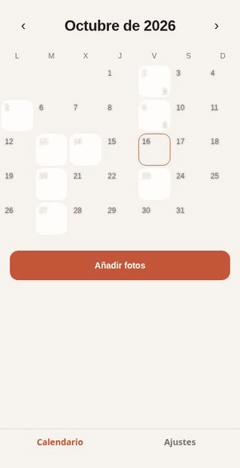
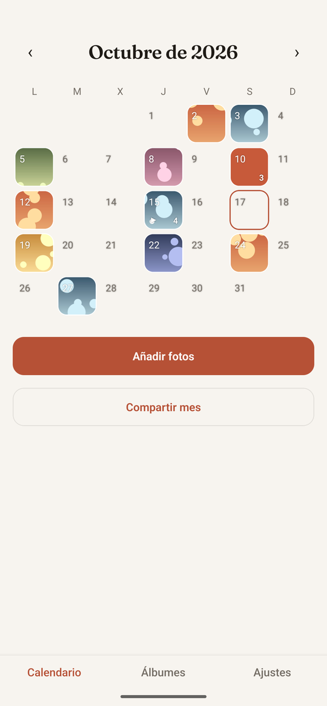
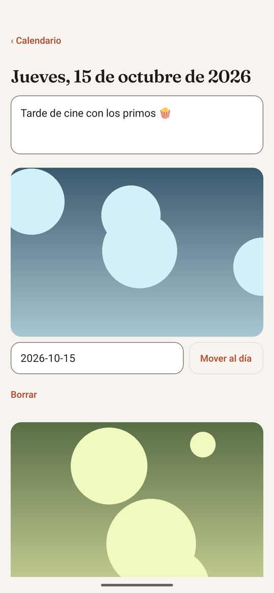
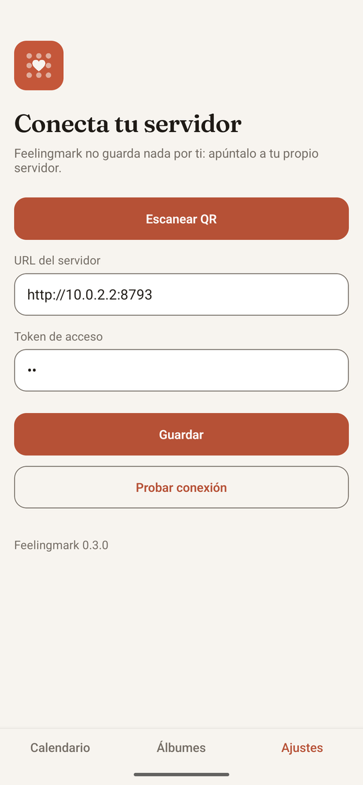

<p align="right"><a href="README.md">English</a> · <b>Español</b></p>

<div align="center">
  
  <h1>Feelingmark</h1>
  <p><b>Un álbum-calendario de fotos y recuerdos que tú alojas.</b></p>
  
</div>

<p align="center">
  
  
  
</p>

**Un álbum-calendario de fotos y recuerdos que tú alojas.** Pones tu almacenamiento; Feelingmark pone el orden: un calendario, un día a la vez.

Nace como alternativa abierta para quienes usaban apps como Dots Memories y no quieren que sus recuerdos queden atados a la suscripción de otro. La app móvil (Android/iOS) y el cliente web comparten el mismo código.

> Estado: v0.3 — usable a diario, con algunas aristas por pulir. Código abierto y autoalojado: tú levantas tu propio servidor y almacenamiento. Lo que sigue: [`docs/roadmap.md`](docs/roadmap.md).

## Características

- Vista de calendario: cada día muestra sus fotos; toca un día para abrirlo.
- La fecha de la foto se lee del EXIF; si no existe, de la fecha del archivo, y siempre puedes moverla a otro día.
- Las fotos duplicadas se detectan y se omiten.
- Tu almacenamiento, tus reglas: los archivos viven en el disco que elijas (sirve un disco extraíble). La app no aloja nada por ti.
- Miniaturas generadas por tu servidor; la app móvil habla con él por HTTP con un token privado.
- Una nota de texto por día y enlaces de solo lectura para compartir un mes.
- **Pestaña Álbumes:** un álbum automático por mes, con portada y número de fotos.
- **Resumen en video del mes** con fundidos suaves y música opcional (ffmpeg, servidores Docker/Node).
- **Subidas fiables:** las fotos entran en una cola con reintentos; lo que falla (sin red) se sube solo la próxima vez que abras la app.
- **Funciona sin conexión:** el calendario muestra lo último visto de cada mes y las miniaturas que ya viste si el servidor no responde.
- Empareja el teléfono escaneando un QR (código de un solo uso que caduca; se muestra al arrancar y en `/pair`).
- Modo claro/oscuro, español e inglés (se aceptan más idiomas).
- Almacenamiento en disco local o en cualquier servicio compatible con S3 (Cloudflare R2, Backblaze B2, MinIO).

Despliegue en Cloudflare Workers + D1 + R2 con un comando ([guía](docs/cloudflare.md)). Almacenamiento experimental en Google Drive ([guía](docs/google-drive.md)). App Android: APK firmados en [Releases](https://github.com/Pedroj-64/feelingmark/releases), sin tienda ([cómo instalar](docs/install.md)). Usar el servidor fuera de casa: [`docs/exposing.md`](docs/exposing.md). Guías: [`docs/personal-use.md`](docs/personal-use.md) (servidor privado + importar tu biblioteca), [`docs/install.md`](docs/install.md), [`docs/storage.md`](docs/storage.md). Hoja de ruta: [`docs/roadmap.md`](docs/roadmap.md).

## Inicio rápido (Docker)

```bash
git clone <este repo> && cd feelingmark
echo "AUTH_TOKEN=$(openssl rand -hex 24)" > .env
echo "DATA_DIR=/ruta/a/tu/disco/feelingmark" >> .env   # opcional, por defecto ./data
docker compose up -d
```

Abre `http://localhost:8787` para el cliente web. En **Ajustes**, escribe la URL del servidor y tu token. La app móvil se conecta igual (usa la dirección de tu computador en la red local, p. ej. `http://192.168.1.10:8787`).

## Desarrollo

Requiere Node 26+ y pnpm.

```bash
pnpm install
pnpm test && pnpm typecheck
cd apps/server && AUTH_TOKEN=dev pnpm dev          # API en :8787
cd apps/mobile && pnpm web                         # o: pnpm android
```

La configuración va en variables de entorno; mira [`.env.example`](.env.example). Nunca subas tu `.env`.

## Estructura

- `apps/server` — API con Hono, SQLite (`node:sqlite` integrado), adaptadores de almacenamiento.
- `apps/mobile` — app Expo (React Native), también exportada como cliente web.
- `DESIGN.md` — sistema de diseño visual.

## Contribuir

Issues y PRs son bienvenidos (ver [CONTRIBUTING](CONTRIBUTING.md) y el [Código de conducta](CODE_OF_CONDUCT.md)). Para añadir un idioma, copia `apps/mobile/src/i18n/en.ts` a `xx.ts` y regístralo en `i18n/index.ts`.

Partes de este proyecto se construyeron con ayuda de un asistente de IA.

## Licencia

[AGPL-3.0](LICENSE)
