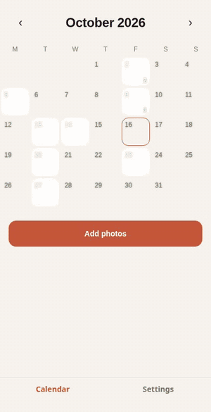

<p align="right"><b>English</b> · <a href="README.es.md">Español</a></p>

<div align="center">
  
  <h1>Feelingmark</h1>
  <p><b>A self-hosted photo calendar and memory album.</b></p>
  
</div>

**A self-hosted photo calendar and memory album.** Bring your own storage; Feelingmark brings the order: one calendar, one day at a time.

Built as an open alternative for people who liked apps like Dots Memories but don't want their memories locked into someone else's subscription. Mobile app (Android/iOS) and web client share the same code.

> Status: early development (pre-0.1). The core works; expect rough edges.

## Features

- Calendar view: each day shows its photos; tap a day to open it.
- Photo date is read from EXIF automatically; if missing, from the file date, and you can always move a photo to another day.
- Duplicate photos are detected and skipped.
- Your storage, your rules: files live on a disk you choose (an external drive works). The app never hosts anything for you.
- Thumbnails generated by your server; the phone app talks to your server over HTTP with a private token.
- A text note for each day, a video recap of the month, and read-only share links for a month.
- Light/dark mode, English and Spanish (more languages welcome).
- Storage on a local disk or any S3-compatible service (Cloudflare R2, Backblaze B2, MinIO).

Deploy on Cloudflare Workers + D1 + R2 with one command ([guide](docs/cloudflare.md)). Planned: Google Drive (experimental), QR pairing. Guides: [`docs/install.md`](docs/install.md), [`docs/storage.md`](docs/storage.md). Roadmap: [`docs/PLAN.md`](docs/PLAN.md).

## Quick start (Docker)

```bash
git clone <this repo> && cd feelingmark
echo "AUTH_TOKEN=$(openssl rand -hex 24)" > .env
echo "DATA_DIR=/path/to/your/disk/feelingmark" >> .env   # optional, default ./data
docker compose up -d --build
```

Open `http://localhost:8787` for the web client. In **Settings**, enter the server URL and your token. The mobile app connects the same way (use your computer's LAN address, e.g. `http://192.168.1.10:8787`).

## Development

Requires Node 26+ and pnpm.

```bash
pnpm install
pnpm test && pnpm typecheck
cd apps/server && AUTH_TOKEN=dev pnpm dev          # API on :8787
cd apps/mobile && pnpm web                         # or: pnpm android
```

Configuration lives in environment variables; see [`.env.example`](.env.example). Never commit your `.env`.

## Project layout

- `apps/server` — Hono API, SQLite (built-in `node:sqlite`), storage adapters.
- `apps/mobile` — Expo (React Native) app, also exported as the web client.
- `DESIGN.md` — visual design system.

## Contributing

Issues and PRs are welcome. To add a language, copy `apps/mobile/src/i18n/en.ts` to `xx.ts` and register it in `i18n/index.ts`.

Parts of this project were built with the help of an AI assistant.

## License

[AGPL-3.0](LICENSE)
